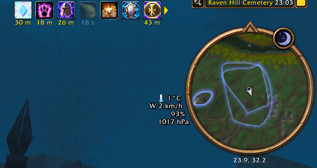
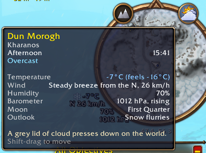
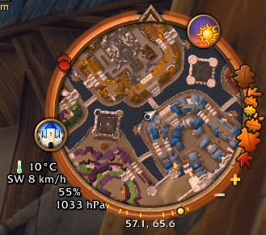

# ImmerseMe: Weather

Living weather on your minimap, for roleplayers in **World of Warcraft: Forever**.

A small sky orb shows the time of day, the moon's phase and what the sky is doing: cloud, rain, fog,
storms, snow, dust or ash. Next to it, a quiet readout gives the temperature, wind, humidity and air
pressure. Hover either one for the full picture.

## What it does

- **A sky for every zone.** Tanaris bakes, Dun Morogh snows, Duskwood sits in fog, the Burning
  Steppes rain ash. Ironforge and dungeons are under stone, out of the wind.
- **Everyone sees the same weather.** It comes from the zone and the realm clock, so when you say
  "it's raining", your roleplay partner sees the rain too. A `/reload` never changes it.
- **Weather changes slowly**, over hours. A falling barometer warns of a storm.
- **Inns are warm, and so are fires.** Step into a tavern and watch the temperature climb.
- **A detailed tooltip**: how it feels, the wind, the moon and a 3-hour outlook.

## Install

1. Download `ImmerseMe_Weather-vX.Y.Z.zip` from the [latest release](../../releases/latest).
2. Extract it into `World of Warcraft/_forever_/Interface/AddOns/`. You should end up with an
   `AddOns/ImmerseMe_Weather` folder.
3. Restart the game (a `/reload` is not enough the first time).

## Commands

| Command | What it does |
|---|---|
| `/imw` | Today's weather in chat |
| `/imw emote` | Describe the weather to the people around you |
| `/imw c` / `/imw f` | Celsius or Fahrenheit |
| `/imw kmh` / `/imw mph` | Wind speed unit |
| `/imw fire` | You're by a fire: warm up (it's remembered next time) |
| `/imw help` | Every other command |

`/weather` works too.

## Good to know

- **English only** for now: all of the addon's text is in English, and it is only tested with an
  English game client.
- Works on its own. It pairs well with
  [ImmerseMe: Geography](https://github.com/holyc4t/ImmerseMe_Geography) (the land) and
  [ImmerseMe: Seasons](https://github.com/holyc4t/ImmerseMe_Seasons) (the year), but needs neither.

## More

- [How the weather works](docs/how-it-works.md) and [customizing it](docs/customizing.md)
- [Contributing](CONTRIBUTING.md)

## License

[MIT](LICENSE). World of Warcraft is a trademark of Blizzard Entertainment. This is a fan project,
not affiliated with or endorsed by Blizzard.
