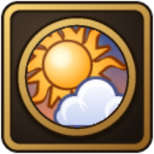
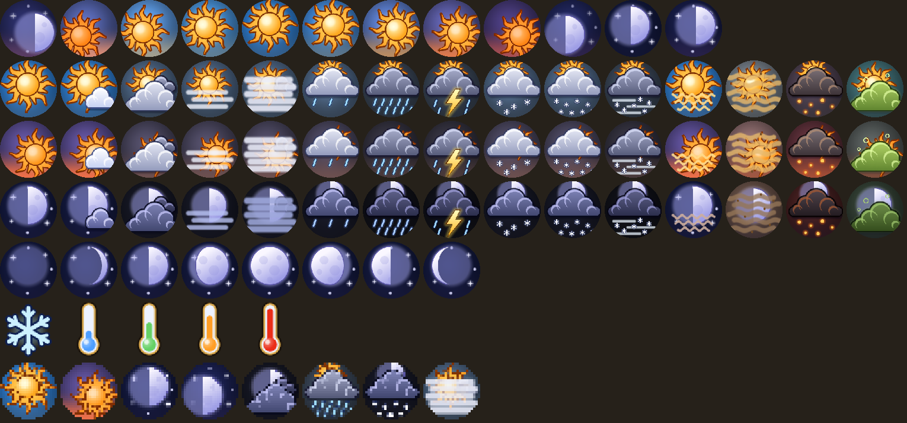

# ImmerseMe: Weather

Living weather for **World of Warcraft: Forever**, built for roleplayers.

A sky orb on your minimap shows the real time of day, the moon's phase and what the sky is
doing (scattered cloud, heavy overcast, fog, rain, thunderstorms, snow, dust storms, ashfall...).
A compact readout hugs the edge of the minimap with the temperature, wind, humidity and barometer.


Part of **ImmerseMe**, a family of small, independent addons for immersive roleplay.

## Features

- **Sky orb**: drawn on the stock day/night icon, in its style. The sky colour follows the hour (dawn glow,
  midday blue, golden evening, red dusk, starry night), the sun and moon travel across it in an arc,
  the moon shows its real phase, and the weather is drawn on top.
  Weather is drawn over it, so a cloudy night shows the moon peeking from behind heavy cloud.
- **Compact readout**: four lines (temperature, wind, humidity, pressure) that follow the curve of the minimap.
  Values count up or down to their new reading, so stepping into a warm tavern is something you watch happen.
- **Warm / cold badge**: a snowflake or thermometer next to the temperature, based on how it *feels* (wind chill, humidity).
- **Every zone has a climate**: Tanaris is scorching, Dun Morogh snows, Duskwood is lost in fog,
  the Burning Steppes rain ash. Instances and cities like Ironforge are under stone and have no wind.
- **Shared weather**: conditions come from the zone and realm time, so every player running the
  addon in the same zone sees the same sky. You can say "it's raining" and your RP partner agrees.
- **Slow, believable change**: weather builds and clears over hours, and a falling barometer warns of a coming storm.
- **Rich tooltip**: hover the orb or the readout for the sky description, feels-like temperature,
  wind strength, barometer trend, moon phase, a 3-hour outlook and a line of flavour text.
- **`/imw emote`**: shares the conditions with people around you as an emote.



*Row 1: a clear sky from 04:30 to 02:00. Rows 2 to 4: every weather at midday, at dusk and at midnight
(clear, fair, overcast, mist, fog, drizzle, rain, storm, flurries, snow, blizzard, haze, sandstorm, ashfall, miasma).
Row 5: moon phases. Row 6: temperature badges.*

## Install

1. Download the latest release, or clone this repository.
2. Copy the `ImmerseMe_Weather` folder into `World of Warcraft/_forever_/Interface/AddOns/`.
   The folder must keep that exact name.
3. Restart the game client fully (`/reload` does not pick up new texture files).

## Commands

`/imw` or `/weather`

| Command | What it does |
|---|---|
| `/imw` | Print the current conditions in chat |
| `/imw emote` | Share the conditions as an emote |
| `/imw c` / `/imw f` | Celsius / Fahrenheit |
| `/imw kmh` / `/imw mph` | Wind unit |
| `/imw time realm` / `/imw time local` | Drive day and night from realm time (default) or your PC clock |
| `/imw readout` / `/imw orb` | Show or hide the readout / the sky orb (the stock day/night artwork comes back when the orb is off) |
| `/imw stock on` / `/imw stock off` | Draw the sky on the stock day/night icon (default), or give the orb its own spot. `/imw stock` alone toggles |
| `/imw icon` | Toggle the warm / cold badge |
| `/imw arc high\|middle\|low` | Where the readout sits along the minimap edge |
| `/imw y <-60..60>` | Nudge the readout up (+) or down (-) in pixels |
| `/imw gap <0..40>` | Distance between the readout and the minimap |
| `/imw font <8..18>` | Readout text size |
| `/imw fire` / `/imw forge` | You're standing by a fire or a forge: the air warms up, and the spot is remembered so it's automatic next time. Cooking or smelting somewhere remembers it too |
| `/imw forget` / `/imw spots` | Forget the remembered fire where you stand / list your discovered fires to share them |
| `/imw lock` / `/imw unlock` | While unlocked, Shift-drag moves the orb (only when it has its own spot) |
| `/imw hide <Frame>` / `/imw unhide <Frame>` | Hide a stock frame, e.g. the default day/night indicator (find names with `/fstack`) |
| `/imw reset` | Restore the default layout |

## Documentation

- [How the weather works](docs/how-it-works.md): the simulation behind temperature, wind, humidity, pressure and sky.
- [Customizing](docs/customizing.md): add zones, tune climates, restyle the art.
- [Changelog](CHANGELOG.md)

## Project layout

```
ImmerseMe_Weather.toc   addon manifest
Data.lua                climates, zone -> climate map, sky conditions, orb colours (safe to edit)
Core.lua                the weather simulation
UI.lua                  orb, readout, tooltip, slash commands
Media/                  generated textures (TGA)
tools/make_icons.py     generates every texture in Media/
tools/preview_icons.py  renders docs/images/icons.png from Media/
docs/                   documentation (not shipped in releases)
```

The tools are plain Python 3 with no dependencies.

## The ImmerseMe suite

Planned modules, each a separate addon:

- **Survival**: hunger, thirst, fatigue and body warmth, driven by Weather (cold, wind and rain mean you need a fire or an inn).
- **Campfire**: resting by a fire or in an inn warms and dries you and passes time.
- **Calendar**: an in-world date with Azerothian months, holidays and the shared moon phase.
- **Journal**: an automatic travel diary written in character.
- **Emotes**: context emotes (`/shiver` in the cold, wiping your brow in the heat) suggested by Weather.
- **Lantern**: darkened screen edges at night and underground unless you carry a light.

Every ImmerseMe addon shares the same addon-list icon frame (gold-bevelled stone square around a
gold-ringed sky medallion); only the emblem and sky colours change. See `suite_icon()` in `tools/make_icons.py`.

## Contributing

Issues and pull requests are welcome. Zone climates are the easiest place to help: if a zone feels
wrong, see [Customizing](docs/customizing.md) and send the change to `Data.lua`.

## License

[MIT](LICENSE). Use it, fork it, build on it.

World of Warcraft is a trademark of Blizzard Entertainment. This addon is a fan project
and is not affiliated with or endorsed by Blizzard. All art in `Media/` is original and generated
by the scripts in `tools/`.
