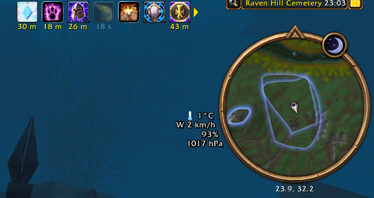
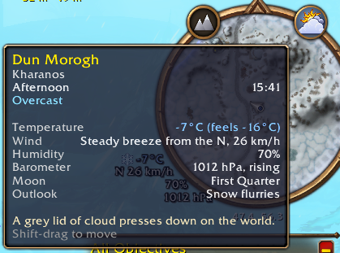

<!--
CurseForge project page for ImmerseMe: Weather. Paste everything below the line into the
project's Description (Markdown).

  Summary (max 125 characters):
    Living, shared weather on your minimap: sun, moon phases, rain, snow and fog, plus temperature, wind and humidity.
  Main category: Roleplay        License: MIT
  Avatar: docs/images/avatar.png (512x512)
  Gallery: docs/images/minimap.png, tooltip.png, icons.png, together.png
  Source: https://github.com/holyc4t/ImmerseMe_Weather
  Issues: https://github.com/holyc4t/ImmerseMe_Weather/issues

Once the Geography and Seasons projects exist, point their links below at their CurseForge pages.
-->
---

# ImmerseMe: Weather

**Living weather on your minimap, for roleplayers.**

A small sky orb shows the time of day, the moon's phase and what the sky is doing: cloud, rain, fog,
storms, snow, dust or ash. Next to it, a quiet readout gives the temperature, wind, humidity and air
pressure. Hover either one for the full picture.

## What it does

- **A sky for every zone.** Tanaris bakes, Dun Morogh snows, Duskwood sits in fog, the Burning
  Steppes rain ash. Ironforge and dungeons are under stone, out of the wind.
- **Everyone sees the same weather.** It comes from the zone and the realm clock, so when you say
  "it's raining", your roleplay partner sees the rain too. A `/reload` never changes it.
- **Weather changes slowly**, over hours. A falling barometer warns of a storm.
- **Inns are warm, and so are fires.** Step into a tavern and watch the temperature climb.
- **A detailed tooltip**: how it feels, the wind, the moon and a 3-hour outlook.

## Commands

- `/imw` - today's weather in chat
- `/imw emote` - describe the weather to the people around you
- `/imw c` / `/imw f` - Celsius or Fahrenheit
- `/imw kmh` / `/imw mph` - wind speed unit
- `/imw fire` - you're by a fire: warm up (it's remembered next time)
- `/imw help` - every other command

`/weather` works too.

## Good to know

- **English only** for now: all of the addon's text is in English, and it is only tested with an
  English game client.
- After installing, restart the game once (a `/reload` doesn't load new textures).
- Part of **ImmerseMe**, a family of small roleplay addons that each work on their own. Pairs well
  with [ImmerseMe: Geography](https://github.com/holyc4t/ImmerseMe_Geography) (the land) and
  [ImmerseMe: Seasons](https://github.com/holyc4t/ImmerseMe_Seasons) (the year).

Bugs and ideas: [GitHub issues](https://github.com/holyc4t/ImmerseMe_Weather/issues).

*World of Warcraft is a trademark of Blizzard Entertainment. This is a fan project, not affiliated
with or endorsed by Blizzard.*
